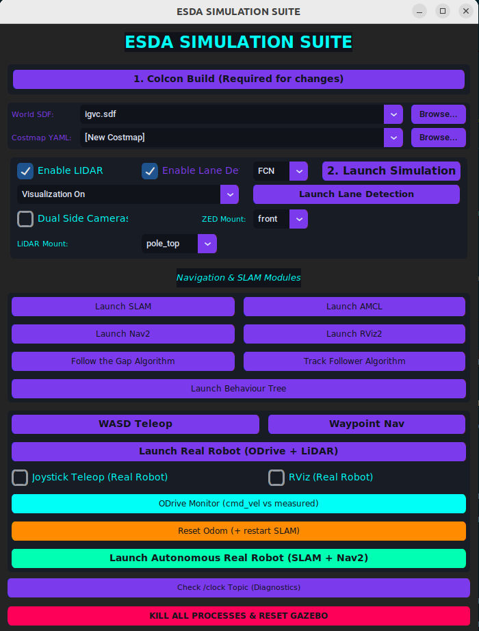

# Running the Real Robot

How to run Asterius on the Jetson with SLAM and Nav2 and drive it to a waypoint.

## Overview
The robot uses a Velodyne VLP-16 over ethernet and an ODrive v3.6 over USB. There is no Gazebo or `ros2_control`.

```text
Wheels:   /cmd_vel -> odrive_bridge.py -> ODrive axis0/axis1
Odometry: ODrive encoders -> /odom + odom->base_link TF + /joint_states
LiDAR:    VLP-16 -> /velodyne_packets -> /velodyne_points -> /scan
Mapping:  /scan -> slam_toolbox -> map->odom
Driving:  /scan + /odom -> Nav2 -> /cmd_vel
```

Lane detection only runs from the purple button (see [Lane Detection](#lane-detection)). Otherwise the robot only avoids what the LiDAR sees and will not follow painted lanes.

## Before You Start
- The LiDAR is powered and its ethernet cable is plugged in.
- The ODrive is connected over USB, with its config already saved on the board. Nothing applies `odrive_configs/odrive_config.json` at launch.
- The wheels are off the ground for a first test, or someone is ready to cut power. The wheels follow any `/cmd_vel` as soon as the launch is up.
- The robot is pointing where you want it. Its starting pose becomes the map origin.

## Launch via UI (Recommended)


1. Run the UI launcher:
   ```bash
   python3 ~/Mk3/esda_simulation_2025/src/esda_simulation_2025/scripts/ui_launch.py
   ```
2. If the code has changed, click **1. Colcon Build**.
3. Click one of the three autonomous buttons. Enter the `sudo` password in the xterm if asked.
   - **Launch Autonomous Robot (ODrive + LiDAR + ZED + SLAM + Nav2)** (red): drives the wheels. Use this to send it to waypoints.
   - **Launch Autonomous Robot + Lanes (ODrive + LiDAR + ZED + SLAM + Nav2)** (purple): the red button plus lane detection, so Nav2 also keeps off painted lane lines.
   - **Launch Autonomous Stack (LiDAR + ZED + SLAM + Nav2, no ODrive)** (green): the same stack without the ODrive, for testing on the bench.
4. Wait until the xterm shows Nav2's nodes are active. Nav2 starts about 8 seconds after everything else.
5. Click **Launch RViz2**, then change **Global Options > Fixed Frame** to `map`.
6. Send a waypoint (see below).

All three buttons also bring up `enP8p1s0` and give it `192.168.10.100/24`, which the Jetson needs to receive LiDAR packets.

The red and purple buttons start `odrive_bridge.py`, so the wheels follow Nav2 as soon as a goal is sent. Keep the wheels off the ground for a first test.

The green button does not start the ODrive, so the wheels never move. Nav2 still plans and publishes `/cmd_vel`, but nothing drives the motors. With no wheel odometry the robot is pinned at the `odom` origin, so keep it still: moving it by hand confuses SLAM.

The ZED starts with depth off. It needs `~/zed_ws` (the ZED ROS 2 wrapper) and `~/zed_ws/zed_nodepth.yaml`; without the wrapper the launch logs that there is no ZED and carries on.

Do not click these while the autonomous launch is running:
- **Launch SLAM** and **Launch Nav2**: the launch already runs both, so they just report an error.
- **Launch Real Robot (ODrive + LiDAR)** or another autonomous button: they are blocked because they all run the LiDAR.
- **Waypoint Nav**: this is the older `waypoint_navigator.py`, which follows fixed waypoints from `igvc_waypoints.yaml`.

The autonomous buttons ignore the **Enable LIDAR** and joystick checkboxes and the mount dropdowns. Tick **RViz (Real Robot)** before clicking one to open RViz with the launch (Fixed Frame `odom`; change it to `map` to see SLAM's map). It always uses the LiDAR low on the chassis and the ZED on the front, and they do not open WASD teleop.

## Launch from a Terminal (No UI, e.g. over SSH)
Use this when there is no screen on the Jetson, for example from a laptop over SSH.

1. SSH into the Jetson. Over Tailscale it is at `100.67.86.95`:
   ```bash
   ssh asterius@100.67.86.95
   ```
2. Start a `tmux` session, so the robot keeps running if SSH drops:
   ```bash
   tmux new -s robot
   ```
3. Bring up the LiDAR network, entering the `sudo` password if asked:
   ```bash
   sudo ip link set enP8p1s0 up
   ip -4 addr show dev enP8p1s0 | grep -q 192.168.10.100 || \
     sudo ip addr add 192.168.10.100/24 dev enP8p1s0
   ```
4. Source the workspaces and launch from the workspace root:
   ```bash
   cd ~/Mk3/esda_simulation_2025
   source ~/zed_ws/install/setup.bash
   source install/setup.bash
   ```
5. Run the launch that matches the button you want.

   All three commands start the same base stack:
   - **`robot_state_publisher`:** the robot model, with the ZED on the front and the LiDAR low on the chassis, so the sensor frames are in TF.
   - **The VLP-16 LiDAR:** `velodyne_driver_node`, then `velodyne_transform_node` to `/velodyne_points`, then `pointcloud_to_laserscan` to `/scan`. A throttled copy is also published on `/velodyne_points_viz` for Foxglove.
   - **The ZED 2i:** the ZED wrapper with depth off, publishing the left image at 640x360, plus a static TF joining it to the robot model's `camera_link`.
   - **SLAM Toolbox:** builds the map from `/scan` and publishes `map -> odom`.
   - **Nav2:** starts 8 seconds after everything else. It plans on `/scan` (plus `/lane_obstacles` when lanes are on) and publishes `/cmd_vel`.

   None of them start teleop, RViz or the virtual lane walls.

   Autonomous Robot + Lanes (the purple button):
   ```bash
   ros2 launch esda_simulation_2025 real_robot_slam_nav.launch.py \
     launch_teleop:=false launch_lane_detection:=true
   ```
   This is the base stack plus two more things:
   - **`odrive_bridge.py`:** drives the wheels from `/cmd_vel` and publishes `/odom`, the `odom -> base_link` TF and `/joint_states` from the encoders. **The wheels move as soon as a goal is sent.**
   - **`lane_detection_esda.py`** (Adaptive mode): finds lane lines in the ZED's left image and publishes them on `/lane_obstacles`, so Nav2 keeps off them, and on `/lane_markers` for RViz. See [Lane Detection](#lane-detection).

   Autonomous Robot (the red button):
   ```bash
   ros2 launch esda_simulation_2025 real_robot_slam_nav.launch.py \
     launch_teleop:=false
   ```
   This is the base stack plus `odrive_bridge.py`, so the wheels drive. There's no lane detection, so Nav2 only avoids what the LiDAR sees.

   Autonomous Stack, without the ODrive (the green button):
   ```bash
   ros2 launch esda_simulation_2025 real_robot_slam_nav.launch.py \
     launch_teleop:=false launch_odrive:=false
   ```
   This is the base stack only. The wheels never move. A static `odom -> base_link` TF stands in for the ODrive, so the robot stays pinned at the origin: keep it still. Use this for bench tests of the sensors, SLAM and Nav2's planning.

Always pass `launch_teleop:=false` over SSH. Teleop opens an xterm, which needs a screen. RViz is already off by default; to see the robot, run RViz on the laptop (see [RViz on a Laptop](#rviz-on-a-laptop)).

Send waypoints from a second tmux window (`Ctrl+B` then `C`) with the command in [Terminal on the Jetson](#terminal-on-the-jetson).

`tmux` keys:
- Detach and leave the robot running: `Ctrl+B` then `D`.
- Reattach after reconnecting: `tmux attach -t robot`.
- Stop the launch: reattach and press `Ctrl+C`. From another shell, `tmux send-keys -t robot C-c` does the same thing.

Launch from the workspace root, because `nav2_params_real_robot.yaml` finds its behaviour tree through a relative `install/...` path.

Useful arguments:

| Argument | Default | Purpose |
|---|---|---|
| `launch_odrive` | `true` | ODrive bridge, so the wheels follow `/cmd_vel` |
| `launch_zed_cam` | `true` | ZED camera (needs `~/zed_ws` sourced) |
| `launch_lane_detection` | `false` | Lane detection on the ZED into `/lane_obstacles` |
| `launch_teleop` | `true` | WASD teleop in its own xterm (needs a screen; the UI buttons set this to `false`) |
| `launch_joy` | `false` | Gamepad teleop |
| `launch_rviz` | `false` | RViz on the Jetson |
| `launch_virtual_lanes` | `false` | Virtual walls either side of the start pose |
| `lane_half_width` | `2.0` | Distance in metres from the start pose to each wall |
| `camera_mount` | `front` | `front` or `pole_top` |
| `lidar_mount` | `low` | `low` or `pole_top` |

## Sending a Waypoint
The robot does not move until it gets a goal. A new goal replaces the current one.

### RViz
Click **2D Goal Pose**, click the target on the map, then drag to set the final heading. The robot starts driving straight away.

### Terminal on the Jetson
```bash
export FASTRTPS_DEFAULT_PROFILES_FILE=~/Mk3/esda_simulation_2025/src/esda_simulation_2025/config/fastdds_jetson.xml
source ~/Mk3/esda_simulation_2025/install/setup.bash
ros2 topic pub --once /goal_pose geometry_msgs/msg/PoseStamped \
  "{header: {frame_id: map}, pose: {position: {x: 3.0, y: 0.0}, orientation: {w: 1.0}}}"
```

In the `map` frame, `x` is forward from the start pose and `y` is to the left.

Nav2 is capped at 0.45 m/s and treats the goal as reached within 0.25 m.

## RViz on a Laptop
RViz on the Jetson can take CPU that SLAM and Nav2 need. To run it on a laptop over Tailscale instead:

```bash
export FASTRTPS_DEFAULT_PROFILES_FILE=<repo>/src/esda_simulation_2025/config/fastdds_remote_jetson.xml
source <repo>/install/setup.bash
rviz2 -d <repo>/src/esda_simulation_2025/config/view_remote.rviz
```

The addresses are hardcoded, so update them if they change:
- `fastdds_jetson.xml`: the laptop, `100.72.211.34`
- `fastdds_remote_jetson.xml`: the Jetson, `100.67.86.95`

The UI button also works with a laptop, because `real_robot_slam_nav.launch.py` sets `fastdds_jetson.xml` for its own nodes.

## Stopping
- Click the same autonomous button again, or **KILL ALL PROCESSES**.
- From a terminal, press Ctrl+C on the launch. `odrive_bridge.py` sets the axes to idle on shutdown.
- Keep a physical way to cut power, because these all stop the robot through software.

The wheels stop if `/cmd_vel` is missing for 0.5 s. Do not use WASD to stop the robot during autonomous driving: it publishes to `/cmd_vel` alongside Nav2, so the two fight. Close WASD before sending waypoints.

## Lane Detection
The purple button, or `launch_lane_detection:=true` with `launch_zed_cam:=true`, runs the Adaptive detector (`lane_detection_esda.py`) on the ZED's left image. It publishes lane points to `/lane_obstacles`, which both Nav2 costmaps already mark as obstacles. SLAM keeps using the plain LiDAR `/scan`.

- **No depth:** the ZED's depth is off, so each lane pixel is placed where its ray meets the ground (`z = -0.1625` in `base_link`), using the camera's real lens model and its TF. This assumes flat ground; on slopes the points land too near or too far.
- **Half-size images:** the ZED publishes at 640x360, which matches the size the detector's pixel thresholds were tuned for.
- **CPU:** the detector uses about 1.7 cores on the Jetson.
- **Tuning:** it was tuned on simulated lanes. Check `/lane_markers` in RViz against the real lines before trusting it.
- **Cones:** cone points need depth, so cones come from the LiDAR only.

## Virtual Lane Walls
`virtual_lane_walls.py` adds two straight walls parallel to the robot's starting heading, enforced by Nav2's keepout filter. They are off by default. Turn them on with `launch_virtual_lanes:=true`.

- They need SLAM's `map` frame.
- They do not follow curves, so point the robot down the lane before launching.
- Do not run them with `waypoint_navigator_recommendation.py`, which uses the same `/keepout_costmap_filter_info` topic.

## Troubleshooting

| Symptom | Check |
|---|---|
| No `/scan`, or the map stays empty | Is the LiDAR powered and plugged in? `cat /sys/class/net/enP8p1s0/carrier` should print `1`. The LiDAR is at `192.168.10.201`; if it has been given a different address, change `lidar_addr` in `ui_launch.py`. |
| Nav2 cannot load its behaviour tree | The launch was started outside the workspace root. |
| Goal accepted but the wheels do not move | Run `ros2 topic echo /cmd_vel`. If Nav2 is sending commands, look for errors from `odrive_bridge` in the launch xterm. |
| Laptop RViz shows nothing | Check the hardcoded Tailscale addresses above. |
| RViz shows the robot but no map | Set the Fixed Frame to `map`. |

## Files

| File | Purpose |
|---|---|
| `launch/real_robot_slam_nav.launch.py` | One-command launch with the usual mounts |
| `launch/launch_odrive_robot.launch.py` | Robot bring-up, with SLAM and Nav2 optional |
| `scripts/odrive_bridge.py` | `/cmd_vel` to ODrive, encoders to `/odom` |
| `scripts/ui_launch.py` | UI launcher, including the autonomous button |
| `scripts/virtual_lane_walls.py` | Virtual lane walls |
| `config/nav2_params_real_robot.yaml` | Nav2 settings for the real robot |
| `config/fastdds_jetson.xml` | DDS profile for the Jetson |
| `config/fastdds_remote_jetson.xml` | DDS profile for a laptop |
